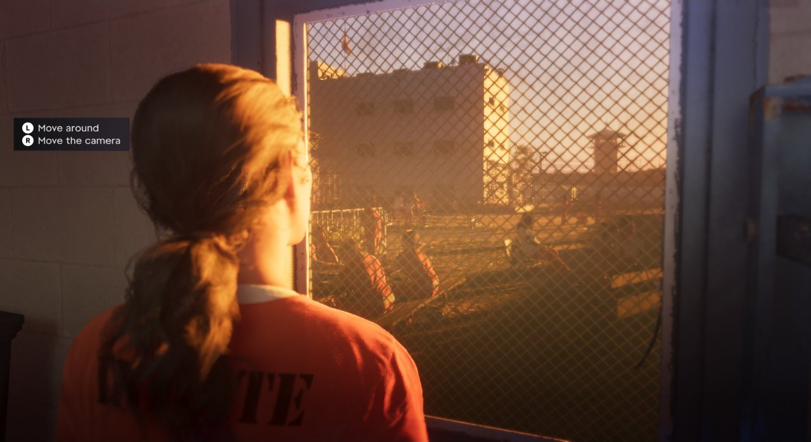
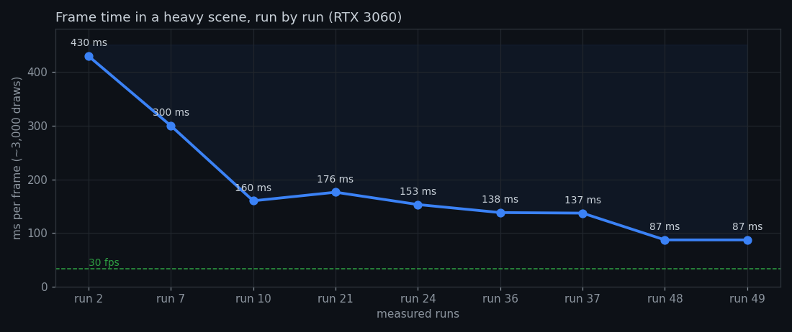
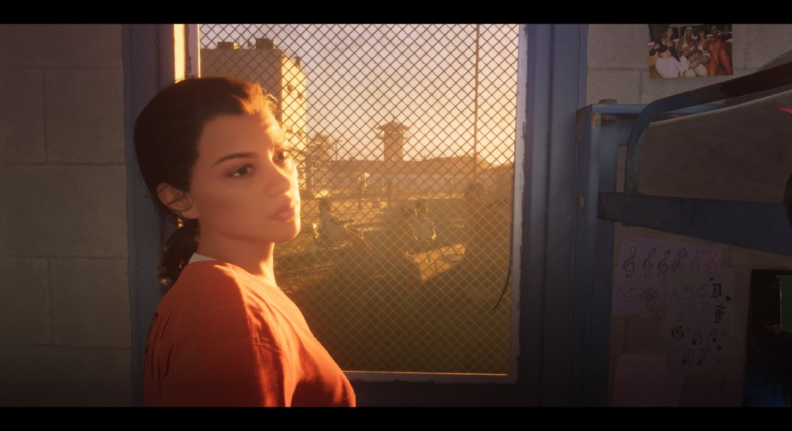
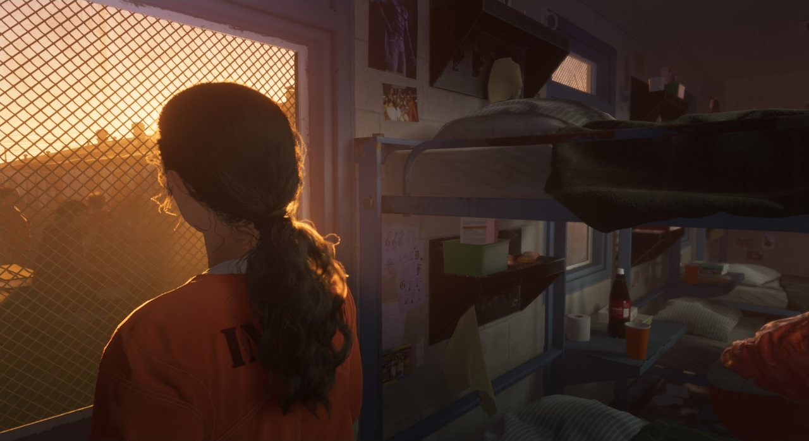
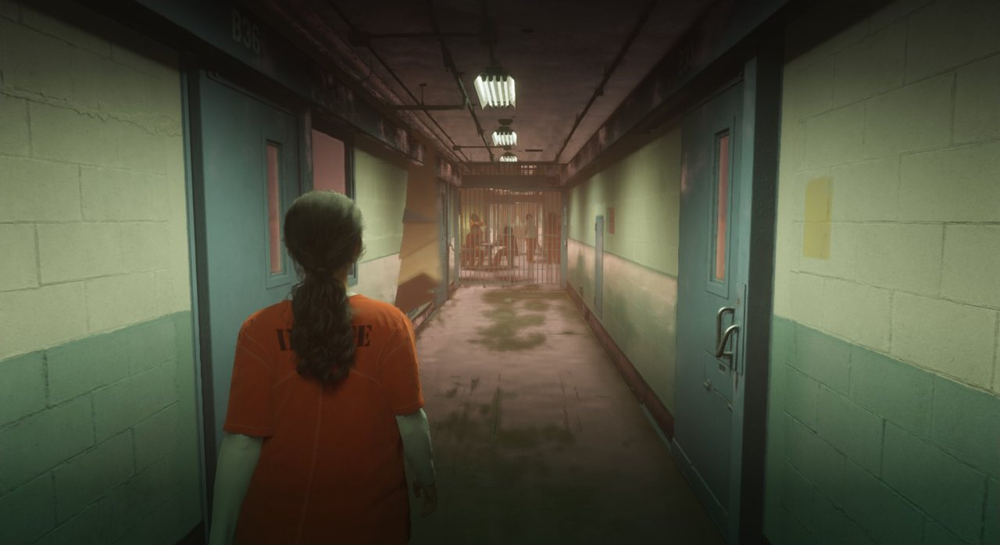
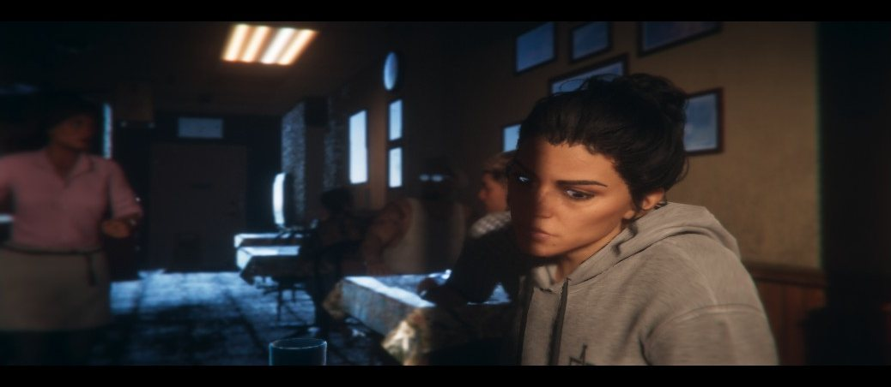
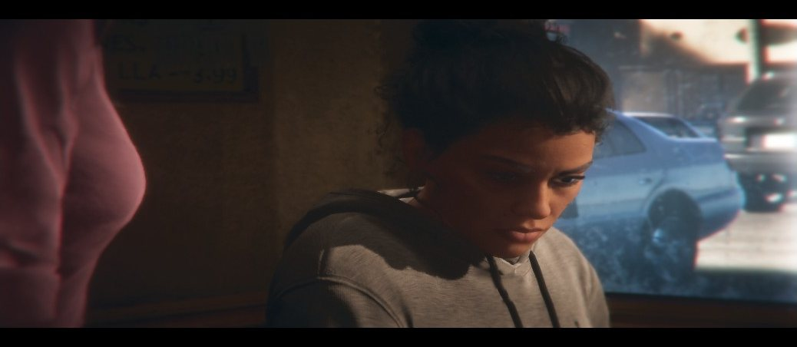
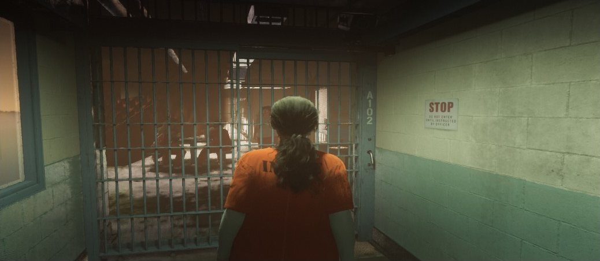

<div align="center">



# victory-rtx3060

**An Xbox Series compatibility layer tuned for NVIDIA mid-range PCs.**<br>
A fork of [VIctory](https://github.com/Marvisak/VIctory) that runs a Series title natively on Windows, measured and tuned run by run on an **RTX 3060 12 GB** with **32 GB of RAM** and **Resizable BAR off**.

[](docs/data/runs.json)
[](docs/data/runs.json)
[](docs/data/runs.json)
<br>
[](#hardware)
[](#hardware)
[](LICENSE)
[](docs/TRACKER.md)
[](https://insenzaboor.github.io/victory-rtx3060/)
[](https://github.com/users/insenzaboor/projects/2)

**[Live dashboard](https://insenzaboor.github.io/victory-rtx3060/)** · **[Project board](https://github.com/users/insenzaboor/projects/2)** · **[Port tracker](docs/TRACKER.md)** · **[How to run](#how-to-run)** · **[What made it fast](#what-made-it-fast)** · **[Credits](#credits)**

</div>

> [!IMPORTANT]
> **This repository contains no game files, code or assets.** You need your own copy of the game. It is not affiliated with or endorsed by the game's developer or publisher, or by Microsoft.

## Where it stands

| | |
|---|---|
| **Typical gameplay** | **10–11 fps** steady (87–104 ms at 2,800–4,750 draws per frame) |
| **Best heavy scene** | **86.7 ms** at 3,093 draws (12 fps) |
| **Heaviest scenes** | 126 ms at 5,900 draws · 139 ms at 6,950 draws |
| **Load to world** | **67 s** |
| **Shaders** | everything the title binds translates; the 27 wave64-only programs (particles, water volumes, hair shadows) translate with `VICTORY_WAVE_LDS_LOOSE=1` |
| **Stability** | title load hang found and fixed (a lock the title's own code leaked); RAM monitor keeps the PC alive on out-of-memory |
| **Frame time since the first world** | **430 ms → 87 ms** (5x) in one day of measured runs |

<p align="center"></p>

## Progress

<!-- PROGRESS:START -->

<p align="center"></p>

| | Category | Done | In flight | Planned |
|---|---|---|---|---|
|  | **Frame time / CPU** | 25 | 11 | 2 |
|  | **RAM and VRAM** | 2 | 9 | 3 |
|  | **Picture correctness** | 2 | 16 | 4 |
|  | **Loads, hangs, crashes** | 4 | 5 | 0 |
|  | **Shader translation** | 1 | 10 | 0 |
|  | **Measurement and automation** | 5 | 3 | 0 |

**39 of 102** items done or decided, **54** merged and waiting for a game run, **9** planned · full list in **[docs/TRACKER.md](docs/TRACKER.md)** · charts in the **[live dashboard](https://insenzaboor.github.io/victory-rtx3060/)**

<!-- PROGRESS:END -->

## Gallery

<table>
<tr>
<td width="50%"></td>
<td width="50%"></td>
</tr>
<tr>
<td></td>
<td></td>
</tr>
<tr>
<td></td>
<td></td>
</tr>
<tr>
<td></td>
<td></td>
</tr>
</table>

<sub>Captured by the autopilot during measured runs on the hardware below, Series S profile, 1080p output. Known glitches remain: see the tracker's rendering section.</sub>

## What made it fast

Every step below was found with a timeline trace or a profile, changed, and measured in a game run. The full list, with switches and commits, is in **[docs/TRACKER.md](docs/TRACKER.md)**.

| Run | Frame time @ ~3k draws | What changed |
|---|---|---|
| 2 | 430 ms | first world |
| 7 | 300 ms | copies made outside locks, window lookups under read locks |
| 10 | 160 ms | **title memory read from VRAM instead of over PCIe** (Resizable BAR is off) |
| 24 | 153 ms | non-blocking logger, fence sweep for the title's GPU watchdog, title threads allowed on every core |
| 36 | 138 ms | **buffers placed in heaps made resident once** (102,900 committed buffers and waits per run, gone) |
| 37 | 137 ms | 16 MB heaps (2 GB less RAM wasted), structured views in place |
| 48 | 87 ms | community ports (XaviFortes, Th3C0D3R), **load-hang fix**: a lock the title's own code leaked |

## How to run

**Needs:** Windows 10/11 x64, a CPU with AVX2, a Direct3D 12 GPU with shader model 6.6 and mesh shaders, Rust (the toolchain is pinned), the MSVC build tools, and your own dump of the title.

```powershell
git clone https://github.com/insenzaboor/victory-rtx3060
cd victory-rtx3060
cargo build --locked --release -p victory
scripts\play-rtx3060.ps1 -Game "D:\path\to\your\dump" -Victory target\release\victory.exe
```

`-Experimental` adds the switches that are merged but not yet verified in a game run (new shader forms, lookup cache, async audio, early tables). `-Console SeriesX` uses the Series X profile.

> [!TIP]
> On a 32 GB PC the title uses about 22–24 GB. Close other heavy programs first. The first run of a new build stutters while the driver makes pipelines; `victory warm --used` makes them ahead.

## Hardware

Every number on this page is from one PC: **AMD Ryzen 9 5900X · 32 GB RAM · NVIDIA RTX 3060 12 GB · Resizable BAR off · Windows Server 2025**, Series S profile, 1080p output. It is CPU-bound: the card is often idle while the CPU translates and submits.

## Tracking

| Where | What |
|---|---|
| **[Live dashboard](https://insenzaboor.github.io/victory-rtx3060/)** | charts of every measured run, filterable list of every port |
| **[docs/TRACKER.md](docs/TRACKER.md)** | every item by category and status, with source, switch, effect and commit |
| **[Project board](https://github.com/users/insenzaboor/projects/2)** | every item as a card: Todo / In Progress / Done, with port status, category, source, switch, effect and commit fields |
| **[Issues](https://github.com/insenzaboor/victory-rtx3060/issues)** | one issue per open item, labelled by category and status |
| [`docs/data/`](docs/data) | the single source of truth: `ports.json` and `runs.json`. `python scripts/tracker/build.py` rebuilds the tracker, progress bars and chart |

## Credits

Built on the work of the community, with history and credit kept in every commit:

- **[Marvisak/VIctory](https://github.com/Marvisak/VIctory)**: the compatibility layer itself
- **[avatarmanz](https://github.com/avatarmanz/VIctory-7900XTX)**: renderer ports 1–7, the measured base set, the pop-in fix
- **[fxceless](https://github.com/fxceless/victory-fork)**, **[DexNom](https://github.com/DexNom/VIctory)**, **[Belobug](https://github.com/Belobug/VIctory-Belobug-AMD)**: much of the tree we build on
- **[deynesdev](https://github.com/deynesdev/Protonida)**: structured views in place, loose-LDS wave64 forms
- **[XaviFortes](https://github.com/XaviFortes/VIctory-RDNA)**: lock-free refresh fast path and more
- **[Th3C0D3R](https://github.com/Th3C0D3R/victory-fork)**, **chabrune**, **cool_fox / CGBJ**, **Rubenpannen**, **SPOOKEXE**, **ApexIV**, **aleksesipenko** and every fork listed in the tracker

The upstream README this fork started from is kept in [docs/UPSTREAM-README.md](docs/UPSTREAM-README.md).

## License

GPL-3.0, as upstream. See [LICENSE](LICENSE).
